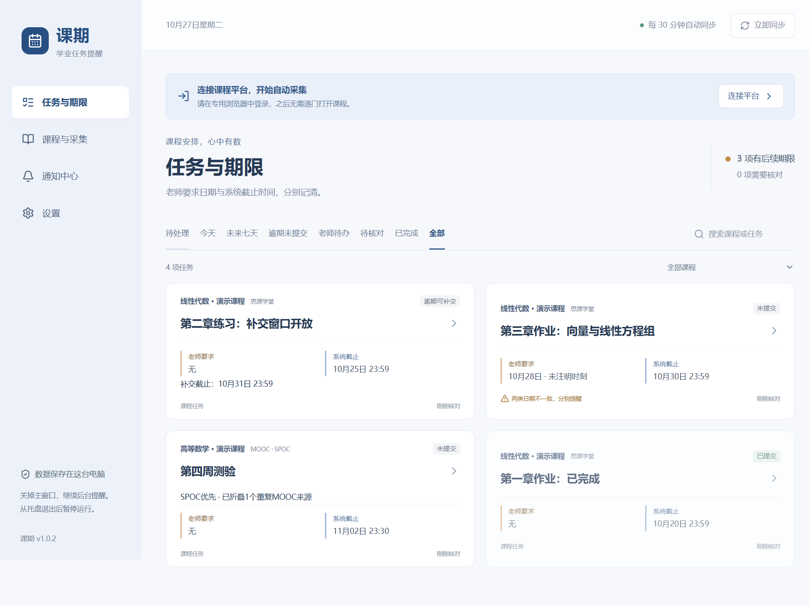
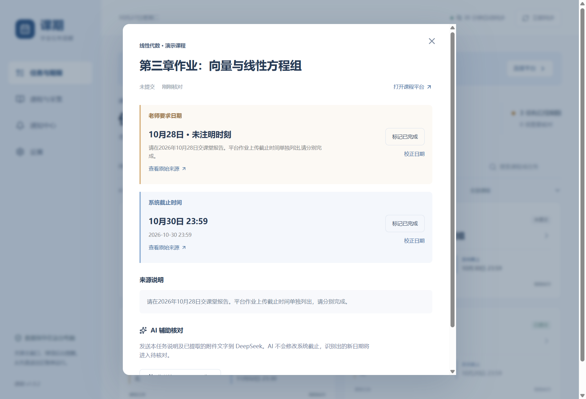
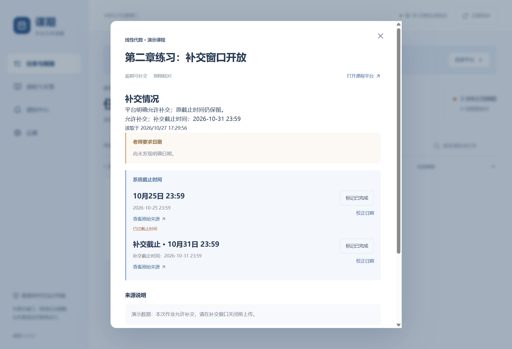

<p align="center">
  
</p>

<h1 align="center">课期 · Course Reminder</h1>

<p align="center">把分散在课程平台里的作业、测验和截止时间，放到同一个地方。</p>
<p align="center"><strong>Windows 桌面应用 · 自动采集 · 独立期限提醒 · 本地数据</strong></p>

课期面向西安交通大学思源学堂与中国大学 MOOC / SPOC，自动发现已参加课程，汇总任务、公告和时间要求。首次登录完成后，无需逐门打开课程，也无需每次手动同步。

**当前版本：1.0.2。** 本仓库提供源码；安装包需在 Windows 本地构建，当前未上传到 GitHub Releases。

[功能预览](#功能预览) · [快速开始](#快速开始) · [AI-辅助](#ai-辅助) · [本机-api](#本机-api) · [开发](#开发) · [使用边界](#使用边界)

## 功能预览

> 下图来自真实应用运行界面，全部使用隔离的合成演示数据，不代表真实课程、提交记录或平台覆盖情况。



| 能力 | 具体行为 |
| --- | --- |
| 自动采集 | 后台发现课程并定时读取，默认每30分钟同步；失败时保留历史数据并展示错误 |
| 多平台汇总 | 支持思源学堂、中国大学MOOC与SPOC，汇总作业、测验、考试、互评及公告要求 |
| 两类日期独立 | 老师要求日期与系统截止分别保存、展示、标记完成和提醒 |
| 状态分类 | 已完成、逾期未提交、老师待办分开查看，支持搜索和按课程筛选 |
| SPOC优先 | 确认重复时优先展示SPOC；保留MOOC来源及原提交状态，独有内容不丢弃 |
| 补交识别 | 保留正常截止，另外记录补交资格与补交截止，安排独立提醒 |
| 附件解析 | 本地读取常见PDF、DOCX、XLSX和图片；支持扫描PDF及图片OCR |
| 桌面提醒 | Windows通知、应用内通知中心、稍后提醒；关闭窗口后可留在托盘运行 |
| 数据管理 | 本地SQLite持久化，支持数据库备份与恢复 |
| 可选扩展 | DeepSeek默认AI提供商，兼容OpenAI / Anthropic协议；提供带令牌认证的本机API |

### 老师要求和系统截止，各自记清

老师要求周三交报告，系统允许周五前上传：课期保留这两个时间，不合并成一个截止，也不会因为平台已提交而自动完成独立的老师要求。只有日期、没有时刻的要求会明确注明。



### 逾期，也可能还有补交机会

页面明确允许补交时显示“逾期可补交”，原截止仍保留。明确给出的补交截止作为另一项期限提醒。成功读取却没有补交说明时显示“无补交说明”，不会凭空判断平台禁止提交。



### 减少重复和无效核对

- MOOC与SPOC任务的课程名、任务名、种类和期限等一致，且唯一匹配时，优先展示SPOC。不同期限、老师要求或明确学期冲突时不折叠；公告保留。
- 不把MOOC的已提交状态转移到SPOC，两者的原始状态各自保留。
- 页面成功读取后，没有日期就显示“无”，没有提交状态就显示“无提交状态”，不单凭信息缺失列入待核对。
- 尚未读取、解析失败或日期需要推断时，仍保留核对入口。本地完成标记不会向课程平台提交作业。

## 快速开始

### 安装与连接

1. 在Windows x64上按下方开发步骤构建，运行生成的 `release/CourseReminder-1.0.2-Setup.exe`。
2. 打开课期，在“课程与采集”中分别打开两个平台的专用登录窗口，自行完成登录及验证码。
3. 按窗口提示结束登录，程序开始后台自动采集；日后优先复用本机专用登录状态。
4. 在“设置”中确认同步间隔、通知和免打扰时间，可选择登录Windows时启动。
5. 在任务详情查看原始来源、本地校正日期，或分别标记各项要求完成。

关闭主窗口会收至托盘；从托盘选择“退出”才会停止运行。电脑关机、休眠或程序退出后，本机无法继续采集和提醒。会话失效时仍需重新登录。

### 数据保存在哪里

用户数据目录为 `%APPDATA%\course-reminder`。设置中可打开该目录、备份或恢复数据库；恢复前会保留当前数据库副本。

数据库备份**不包含登录状态和API Key**，不能替代整机迁移。认证信息只留在本机，不随源码仓库上传。

## AI 辅助

在“设置 → AI辅助”中选择提供商，填写服务地址、模型和API Key。默认提供商为DeepSeek，保留OpenAI与Anthropic协议兼容配置。Key通过本机系统加密保存。

AI为可选功能。只有启用并允许发送课程文字后，点击任务分析才会把该任务说明及相关已解析附件文字发送给所选服务。调用受每日次数上限约束，费用按提供商规则计算，不会在后台自动执行付费分析。

AI识别的候选日期进入待核对，不覆盖系统截止。协议集成已通过本地模拟服务验证；真实服务的可用性取决于你配置的地址、模型和有效Key。

## 本机 API

默认关闭。启用后默认监听 `http://127.0.0.1:18427`，使用设置中生成的Bearer令牌认证，仅供本机程序集成。

| 方法与路径 | 用途 |
| --- | --- |
| `GET /v1/status` | 运行与采集状态 |
| `GET /v1/tasks` | 任务列表 |
| `GET /v1/courses` | 课程列表 |
| `GET /v1/notices` | 通知列表 |
| `GET /v1/openapi.json` | OpenAPI接口说明 |
| `POST /v1/sync` | 请求后台同步 |
| `POST /v1/ai/analyze` | 分析指定任务，请求体为 `{"taskId":"任务ID"}` |

所有请求携带 `Authorization: Bearer <令牌>`。令牌可轮换；AI接口共用应用的发送授权和调用上限。不要将令牌写入仓库、日志或网页脚本。API不提供提交作业、答题或修改课程平台状态的功能。

## 开发

### 环境与启动

当前开发与打包环境为 **Windows x64 + Node.js 24 + npm**。使用锁文件安装依赖：

```powershell
git clone https://github.com/waaogg/course-reminder.git
cd course-reminder
npm ci
npm run setup:browser
npm run dev
```

这是私有仓库，克隆需要相应访问权限。浏览器安装与首次准备资源需要网络；登录时使用应用专用配置，不复用日常浏览器的默认配置。

### 检查与构建

```powershell
# 静态检查与测试
npm run typecheck
npm run test:unit
npm run test:integration
npm run test:store

# 构建应用与桌面交互验证
npm run build
npm run test:e2e

# 生成Windows安装包，自动准备浏览器与OCR资源
npm run dist:win

# 验证打包资源及桌面交互
npx tsx scripts/smoke.ts --packaged --resources
```

输出目录为 `release/`。安装包包含专用Chromium及中英文OCR模型，体积较大；目前未配置代码签名，Windows可能显示发布者未知。

README截图可通过 `npx tsx scripts/readme-screenshots.ts` 重新生成；须先执行 `npm run build`。该脚本使用独立演示数据库，不读取个人登录配置或课程数据库。

### 代码结构

```text
src/
  collector/       平台适配器与独立采集进程
  domain/          日期、任务状态、去重与补交规则
  extraction/      附件文字提取与本地OCR
  main/            桌面主进程、SQLite、通知、AI及本机API
  preload/         桌面通信桥接
  renderer/        React界面
  shared/          共享数据类型
scripts/           构建资源、演示截图与验证脚本
tests/             单元与集成测试
docs/              设计、实现方案和版本记录
```

### 文档

- [实现方案](docs/IMPLEMENTATION-PLAN.md)与[产品方案](docs/PLAN.md)
- [AI与API设计](docs/AI-AND-API.md)
- [版本1.0.2说明](docs/RELEASE-NOTES-1.0.2.md)与[验收记录](docs/RELEASE-VALIDATION.md)

方案文档包含历史过程，当前行为以最新版本说明和源码为准。本机续接记忆、私人平台研究、运行快照、浏览器配置、依赖与安装包均不在仓库中。

## 使用边界

- 自动采集依赖本机开机、网络可用、程序常驻和有效登录态，不能承诺永久免登录。
- 平台页面结构可能变化，采集覆盖与错误会显示在应用中。部分失败时保留的旧记录不代表刚刚核验。
- 支持PDF文本、扫描PDF、图片OCR、DOCX正文及内嵌图片OCR、XLSX单元格文字。单文件上限25MB，PDF最多30页，DOCX最多20张PNG/JPEG/WebP图片。
- 旧DOC/XLS、PPT、压缩包、加密文档及复杂图片表格不能保证自动解析。OCR或日期识别可能有误，应结合原始来源核对。
- 应用读取课程内容并提供提醒，不代交作业、不参加考试、不自动答题，也不修改课程平台内容。
